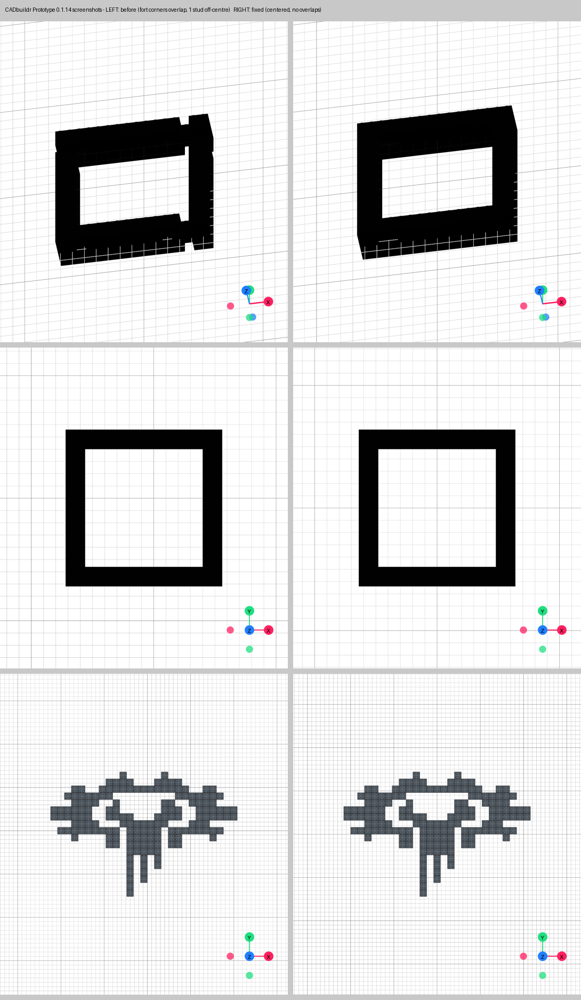

# cadbuildr_projects.lego

## Summary

LEGO-inspired primitives and assembly builders in the `cadbuildr_projects` namespace.

## Tags

cad, python, lego, assembly

## Usage

Bricks carry foundation anchors (`top`, `bottom`, `seat`) and are placed with
`StudInterface`, which adds `RigidJoint`s instead of translating parts by hand:

```python
from cadbuildr.foundation import Assembly, show
from cadbuildr_projects.lego import LegoBrick, LegoFort, StudInterface

assembly = Assembly()
studs = StudInterface(assembly)
studs.ground(LegoBrick(4, 2))
studs.on_top_of(LegoBrick(2, 2), at=(1, 0))   # one stud over, one level up
studs.beside(LegoBrick(4, 2), at=(4, 0))      # same level, 4 studs along x
show(assembly)

show(LegoFort(n_length_studs=16, n_width_studs=16, n_layers=3))
```

For layouts on an absolute grid use `studs.place(brick, at=(n_x, n_y, n_z))`;
`StudInterface(assembly, grid_origin=(x, y, z))` re-centers the whole model.



## Dependencies

### Upstream

- cadbuildr-foundation

### Downstream

- (none)

## GitHub Pages demo (Vite + R3F)

Static browser demo for `kernel-api` + Pyodide lives next to this package:

`github-io/` — from that folder run `pnpm install` and `pnpm dev` after `poetry build` in this repository root (see `github-io/README.md`: local wheel is served from `dist/`, foundation still from PyPI). Dependencies use published `@cadbuildr/cad-kernel-r3f` and `@cadbuildr/cad-pyodide-runtime` on npm, not monorepo workspace links.
